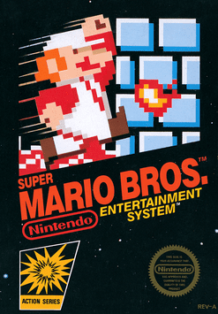
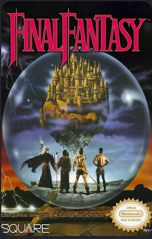

This is NesPY, an experimental emulator built in python and can run only mappers 0 and 1 NES games at full speed.
No third party optimization libraries such as Numpy, PyPy, Cython, Numba, etc were used. This project has its
own bulit in compiler that translates guest code into byte code.
Here are the following games it can run:

A JIT (Just-in-Time) compiler is an optimization engine whereby guest codes are translated into client code only once and cached in a memory block
for future execution. The technique used here was that two caches were created....one for the client code
translated in python strings and stored in a dictionary lookup table with their opcodes as keys. The other cache
was for storing compiled blocks of code to be ran. Another optimization technique that helped was compiling
and executing several blocks of code at a time. 

Result:
When testing the compiler with Klaus' ROM, the execution speed was estimated to be 
5+ mhz which is 3.5x faster than the native clock speed for the original NES hardware. Hence there was 
enough headroom for the games tested above to run at full speed once the mappers and bus were attached. When the 
framerate is uncapped, each game can run upto 100FPS. 

Future work:
The audio components of the hardware are yet to be added. More advanced mappers are currently in development
as this emulator can only run the premitive ones seen in mappers 0 and 1. 

